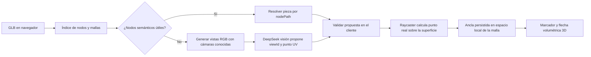

# Plan: entender y señalar referentes dentro de un GLB

## Objetivo

Permitir que el tutor responda preguntas sobre el GLB abierto por un estudiante y que pueda señalar en el visor la pieza o región a la que se refiere. La señal debe quedar anclada a la geometría 3D y seguirla cuando el estudiante rote o acerque el modelo.

La solución debe servir para dos clases de archivos:

1. **GLB semántico:** contiene nodos, piezas o mallas con nombres útiles y, a veces, jerarquía.
2. **GLB sin semántica:** contiene una o pocas mallas fusionadas, como puede ocurrir con un escaneo de Polycam. El nombre, las piezas y sus funciones no se pueden recuperar de los metadatos del archivo por sí solos.

Este documento es un plan de implementación. No agrega todavía el tutor, el índice de escena, la localización ni la anotación al visor.

## Hallazgos actuales

- `web/src/app/features/exploration/glb-viewport.ts` carga `gltf.scene` con Three.js, centra la cámara y permite orbitar con `OrbitControls`. Todavía no indexa piezas ni ofrece raycasting de selección o capas de anotación.
- `web/src/app/features/exploration/exploration-page.ts` abre GLB del catálogo o un archivo local temporal. No hay chat del tutor implementado.
- El flujo de catálogo actual mantiene los GLB locales en el navegador y no los sube al servidor; ver ADR-0007.
- `assets/blender/objeto.glb` tiene un nodo y una malla sin nombre semántico, un material y aproximadamente 29.000 vértices. En el render parece una carcasa azul con ranuras y etiquetas, pero el archivo no declara qué objeto es ni qué función tienen sus regiones.
- El modelo de guitarra de la demo anterior es un ejemplo de GLB semántico: sus piezas están separadas y tienen nombres descriptivos.

## Decisión de diseño

Combinar datos de escena con percepción visual. El modelo de lenguaje no debe enviar una coordenada 3D inventada. Para una malla genérica, debe escoger una región en una imagen generada desde una cámara conocida; el visor convierte ese punto de imagen en una intersección validada con la malla.



DeepSeek interpreta la pregunta, el árbol de escena y/o las imágenes. Three.js conserva la autoridad sobre la geometría: solo el cliente calcula y acepta el punto final mediante raycasting.

## Flujo de carga y representación del modelo

### 1. Crear un índice local de escena

Al terminar `GLTFLoader.loadAsync`, recorrer `gltf.scene` y asignar a cada nodo de la sesión:

- identificador interno estable durante esa carga;
- ruta jerárquica (`nodePath`), nombre original y nombre visible saneado;
- tipo de nodo, malla, grupos/materiales, transformaciones y límites locales/mundiales;
- cantidad aproximada de vértices/triángulos y si la malla tiene nombre útil;
- referencia al objeto Three.js, que nunca se envía como dato del modelo de lenguaje.

No tratar un nombre automático como `Mesh_0` o `Object_1` como descripción semántica. No enviar todos los vértices al modelo de lenguaje.

### 2. Resolver GLB con piezas semánticas

- Construir un resumen compacto del árbol con nombres, rutas y límites de los nodos.
- Cuando el tutor mencione una pieza, exigir que la respuesta seleccione uno de los identificadores presentes en ese índice.
- Si el nodo seleccionado contiene una malla completa, elegir un punto de superficie visible de esa malla desde la cámara actual o desde una vista de enfoque. No señalar automáticamente el centro del bounding box si queda en el aire o detrás de la superficie.
- Si hay varios nombres o piezas parecidas, presentar opciones o pedir aclaración en vez de elegir a ciegas.

### 3. Resolver escaneos o mallas sin nombres

- Renderizar un conjunto acotado de vistas del mismo modelo (por ejemplo, frente, atrás, laterales y diagonales), con fondo limpio y resolución ajustada al coste de inferencia. Añadir la vista actual del estudiante cuando ayude a interpretar el contexto de la pregunta.
- Asociar a cada imagen un `viewId` y conservar exactamente su cámara, matrices de proyección, tamaño de imagen y transformaciones del modelo.
- Pedir al modelo con visión que señale una región en una vista concreta mediante coordenadas normalizadas `(u, v)` y una breve descripción visual. No aceptar coordenadas mundiales generadas por el LLM.
- Para selección fina, permitir una segunda etapa opcional de segmentación 2D que entregue una máscara de región. Proyectar la máscara usando la misma cámara y usar raycasts para agrupar los puntos de superficie relacionados. La segmentación refina la región; no inventa su función semántica.
- Si la propuesta es ambigua, está fuera de la imagen o no intersecta la malla, no crear la anotación. Pedir al estudiante que rote el modelo o aclare cuál de las regiones quiere.

Una foto externa del objeto puede servir como evidencia visual adicional para reconocerlo, pero no se puede convertir en un ancla del GLB sin conocer su correspondencia y calibración respecto al modelo. Para ubicar una parte, usar vistas generadas desde el GLB o calibrar explícitamente la foto.

## Contrato de localización

Separar la respuesta pedagógica de la propuesta visual. Usar un contrato estructurado y validado en lugar de interpretar texto libre como una acción. Forma conceptual inicial:

```ts
type LocatorProposal =
  | {
      kind: 'semantic-node';
      nodePath: string;
      label: string;
      confidence: number;
    }
  | {
      kind: 'image-point';
      viewId: string;
      uv: [number, number]; // valores normalizados de 0 a 1
      label: string;
      confidence: number;
    }
  | { kind: 'none'; reason?: string };
```

El cliente debe validar que `nodePath` exista o que `viewId` corresponda a una imagen de la sesión, que `uv` esté dentro de `[0, 1]`, y que la propuesta produzca un objetivo geométrico permitido. Definir umbrales de confianza con ejemplos/evaluación; no fiarse del número de confianza que el propio LLM declara sin calibración. Si hay dudas, responder sin flecha y pedir aclaración.

Al validar una propuesta `image-point`:

1. Convertir `(u, v)` al espacio de coordenadas de pantalla utilizado por Three.js.
2. Crear un rayo desde la cámara guardada para `viewId`.
3. Ejecutar `Raycaster` contra las mallas del modelo, excluyendo luces, cámara, controles y objetos de anotación.
4. Elegir la intersección visible más cercana que cumpla las reglas de oclusión.
5. Guardar `nodePath`/ID de malla, punto local, normal local, `faceIndex` si está disponible, etiqueta y procedencia de la propuesta.

El ancla debe estar en espacio local de la malla para que siga el objeto si el root se transforma. Para geometría estática, guardar punto y normal locales; usar el índice de triángulo como dato auxiliar y no como única identidad si la geometría puede cambiar.

## Señal visual 3D

Implementar una capa independiente (`annotationRoot`) añadida a la escena después de cargar el GLB. Cada anotación incluirá:

- **Punta:** cono/flecha 3D cuya punta termina en el punto anclado y cuya orientación toma en cuenta la normal local transformada a espacio mundial.
- **Marcador:** aro/halo y centro visible ajustados a la superficie para precisar el objetivo.
- **Vástago:** cilindro o tubo con grosor perceptible; no usar una línea de un solo píxel como única señal.
- **Etiqueta:** placa 3D legible que siga un punto del espacio y mire a cámara (billboard), conectada al vástago. Mantener el texto corto y distinguirlo visualmente de la respuesta del chat.

Al orbitar, actualizar la orientación de la etiqueta y comprobar la oclusión del objetivo. No dibujar el objetivo a través de una superficie opaca como si fuera visible. Si el objetivo queda oculto, indicar que hace falta rotar el modelo o mover la cámara. Dimensionar marcador y vástago en función de la escala/cámara para mantener legibilidad en objetos muy grandes o pequeños.

Todas las partes de anotación se guardan en un grupo separado, no se incorporan al GLB, no participan en raycasts del modelo y deben eliminarse al cerrar/reemplazar el asset. Permitir quitar una anotación y enfocar la cámara en su región.

## DeepSeek, privacidad y límites

- DeepSeek puede analizar imágenes mediante su API de visión actual; confirmar modelo, esquema de entrada, límites, precio y disponibilidad al iniciar la implementación, consultando la documentación oficial vigente.
- Mantener la clave de API en el servidor; no exponerla en Angular ni en el navegador.
- Los GLB de selección local deben seguir sin subirse ni persistirse. Para usar el tutor remoto, el cliente puede enviar solo el texto de la pregunta, el resumen estructural relevante y un número acotado de renders comprimidos; explicar esto al estudiante antes del primer envío. Si el producto exige que nada salga del dispositivo, usar inferencia visual local como decisión separada.
- Para modelos del catálogo, enviar solo las vistas necesarias y respetar el contrato y las políticas del tutor.
- El tutor no debe afirmar funciones internas que no son visibles ni presentes en los metadatos. Un escaneo de superficie no permite deducir una pieza interior que no fue escaneada.
- El plan no requiere Blender MCP en tiempo de ejecución: MCP es para autoría e inspección de assets, no para que los estudiantes localicen regiones al hacer preguntas.

La integración del tutor debe seguir la arquitectura modular documentada en `README.md` y `docs/decisions/0002-hexagonal-backend.md`: el caso de uso depende de puertos, DeepSeek se implementa como adaptador de salida y el contrato HTTP se actualiza primero en OpenAPI si se añade un endpoint. El navegador Three.js mantiene el cálculo del ancla en el cliente.

## Entrega por etapas

1. **Índice y ancla manual:** indexar nodos/mallas, añadir selección por click con `Raycaster` y almacenar la intersección en espacio local. Esto valida transforms, limpieza y selección sin IA.
2. **Anotación 3D:** dibujar marcador, flecha volumétrica y etiqueta billboard para un ancla seleccionada manualmente. Comprobar órbita, zoom, oclusión y cambio de modelo.
3. **Resolución semántica:** pasar árbol compacto al tutor y validar que sus selecciones pertenecen a nodos existentes. Empezar con piezas conocidas como la guitarra.
4. **Localización visual:** generar vistas con cámara asociada, aceptar propuestas UV estructuradas, raycastarlas y probarlas sobre `objeto.glb` y otros GLB fusionados.
5. **Refinamiento opcional:** añadir segmentación de máscara, desambiguación y controles pedagógicos solo si las pruebas de localización puntual no bastan.

## Criterios de aceptación

- Un GLB con piezas nombradas permite seleccionar un nodo válido y anclar una anotación a una superficie real de esa pieza.
- Un GLB anónimo de una sola malla como `objeto.glb` permite seleccionar una región visible desde una vista conocida y crear el ancla mediante raycasting.
- Las coordenadas del modelo de lenguaje nunca se usan directamente como XYZ; toda anotación se valida contra el índice actual y la escena cargada.
- La flecha conserva su punto en la geometría al orbitar, acercar, cambiar el tamaño del visor y transformar el root del modelo.
- El objetivo no atraviesa superficies opacas para indicar una zona que no se ve; cuando no se puede resolver, el tutor solicita una vista o aclaración.
- Reemplazar el GLB invalida referencias y anotaciones del asset anterior; cerrar el visor libera geometría, materiales, texturas y recursos añadidos.
- El modelo local no se sube como archivo. Las imágenes que se envíen al proveedor de IA se limitan a las vistas necesarias y su tratamiento se comunica al usuario.
- El tutor puede responder sin localizador (`kind: 'none'`) cuando la pregunta no necesita una señal espacial o no hay evidencia suficiente.
- La implementación añade pruebas para índice de escena, validación de propuestas, conversión cámara/rayo/ancla, oclusión y render de la anotación, además de las verificaciones normales del proyecto.

## Fuentes técnicas

- [DeepSeek API: Vision](https://api-docs.deepseek.com/guides/vision/) — entrada de imágenes a modelos de visión.
- [Three.js: GLTFLoader](https://threejs.org/docs/pages/GLTFLoader.html) — carga de escenas glTF/GLB.
- [Three.js: Raycaster](https://threejs.org/docs/pages/Raycaster.html) — intersección entre rayos y objetos de la escena.
- [AuraTeach: visor actual](../../web/src/app/features/exploration/glb-viewport.ts)
- [ADR-0007: catálogo y assets 3D](../decisions/0007-model-catalog-assets.md)
